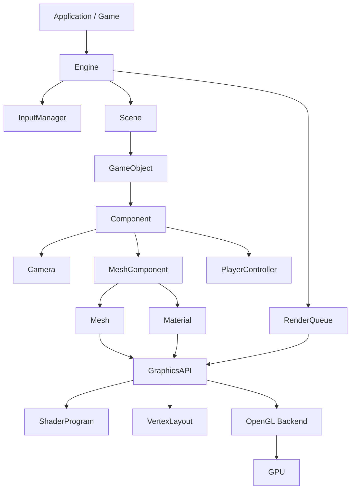

## 1) About
A C++ game engine built from scratch, currently using OpenGL for rendering with Vulkan planned as a second graphics API in the future.

This project is attempting to building a modular engine primarily for game development use.

## 2) Prerequisites
* CMake ≥ 3.10
* A C++17-capable compiler:
  * Windows: MSVC (Visual Studio), or clang/MinGW
  * macOS: Apple Clang (Xcode command line tools)
  * Linux: GCC or Clang
* Platform SDK / development tools:
  * Windows: install “Desktop development with C++” (for MSVC)
  * macOS: xcode-select --install
  * Linux: install build-essential (Debian/Ubuntu) or equivalents

## 3) Project Structure
This project is designed around a modular architecture with clear separation between engine systems, rendering, scene management, and game-specific code.

```text
├── engine/
│   ├── source/
│   │   ├── Application
│   │   ├── Engine
│   │   │
│   │   ├── graphics/
│   │   │   ├── GraphicsAPI
│   │   │   ├── ShaderProgram
│   │   │   └── VertexLayout
│   │   │
│   │   ├── input/
│   │   │   └── InputManager
│   │   │
│   │   ├── render/
│   │   │   ├── Material
│   │   │   ├── Mesh
│   │   │   └── RenderQueue
│   │   │
│   │   └── scene/
│   │       ├── Scene
│   │       ├── GameObject
│   │       ├── Component
│   │       └── components/
│   │           ├── Camera
│   │           ├── MeshComponent
│   │           └── PlayerController
│
└── source/
    ├── Game
    └── main
```



### Engine
Responsibilities:
- Initializes engine subsystems
- Manages the game loop
- Executes update and render passes
- Coordinates input, scene management, and rendering

### Application
Responsibilities:
- Startup initialization
- Game logic
- Resource setup
- Shutdown procedures

### Scene
Responsibilities:
- Object lifetime management
- Scene-wide updates
- Traversal during rendering

### GameObject
Responsibilities:
- Owning components
- Transform hierarchy management
- Acting as the bridge between game logic and engine systems

### RenderingQueue
Responsibilities:
- Gathering visible renderable objects
- Storing render commands for the current frame
- Submitting rendering work to the graphics layer

### GraphicsAPI
Responsibilities:
- Abstracting graphics backends
- Managing rendering commands
- Providing API-independent rendering functionality (Current OpenGL, planned Vulkan integration TBD)

### ShaderProgram
Responsibilities:
- Compiling shaders
- Linking shader programs
- Managing uniforms
